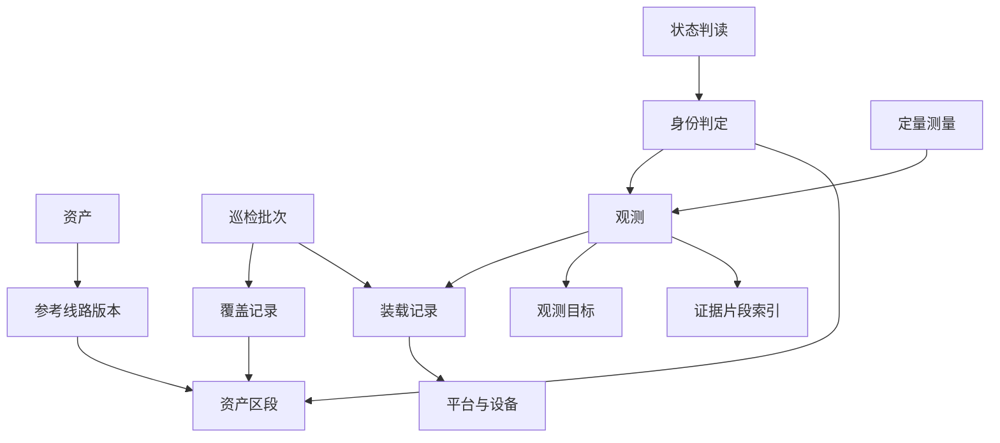

# UUV 海底管道与海缆外部巡检感知本体 v0.1

## 先读这个案例

区域 A 是虚构的 100 m × 100 m 正方形。P01 自西向东，C01 自南向北。沿每条线路自起点计程，0–40 m、40–60 m、60–100 m 分别为首段、交叉区段和末段。两线在各自 50 m 处相交。用 EPSG:32631 表达模拟平面坐标，单位为米。线路由起点指向终点；区间边界按左闭右开解释，末段包括终点。有效覆盖按整个区段预先标注，遇到部分覆盖应先切分区段。本版没有对声呐条带做几何求交。

第一批声呐记录 O1 看见线状特征 T1，允许它同时对应管段和缆段。第二批视频 O2 提供身份和裸露证据，却看不到支承面。因此可以确认局部裸露，悬跨仍为证据不足。两个批次使用同一目标编号是模拟的跨批次配准假设。模拟真值仅供独立核对，不导入实例库。证据片段编号是模拟索引，未附原始声像和视频。

## 概念关系图

## 术语字典与使用规则

|概念|定义与边界|
|---|---|
|调查区、参考线路、区段|区域限定调查范围；参考线路是资产某版本的空间基准；区段由线路版本和起止里程定位。|
|有效覆盖|给定批次取得可用数据的空间范围。按区段记录“有效覆盖”或“缺口”。没有覆盖记录应读作未知。|
|目标与资产|目标是数据中可关联的特征，资产是登记对象。身份判定允许多个候选。|
|观测与状态判读|观测保留方法来源、时间、对象、结果和片段；判读引用身份记录，说明现象、证据状态及理由。新判读追加保存。|
|裸露、悬跨|裸露关注外部覆盖物，悬跨关注底部支承。两项分别判读。|
|覆盖厚度、下埋深度|前者从缆顶到其上方覆盖层表面；后者依指定海床参考面量至缆顶。两者取值均应注明本项目采用的参考面、单位和方法。未测留空，不能补零。|
|测量与证据|测量含量名、数值、单位和参考定义；方法通过观测所在装载记录追到设备。证据片段以文件号和帧、时间或 ping 范围定位。|

完整的类和属性以 ontology.ttl 为准。平台、传感器、观测与 SOSA 对齐；空间要素复用 GeoSPARQL 的要素和 WKT 类型。参考线路版本按独立实例保存。批次与观测采集时间分别建模。

## 使用与验收

1. 用 SQLite 浏览器打开巡检实例.sqlite，按 Segment → Identity → Observation 追查证据。verify.py 收录六项能力问题、SQL 和预期答案；验收结果.txt 是实际查询输出。
2. 用 Protégé 打开 ontology.ttl。instances.ttl 是相同模拟实例的 RDF 表达，可与本体加载到同一 RDF 图。
3. 在安装 pySHACL 的环境运行 `pyshacl -s shapes.ttl -e ontology.ttl instances.ttl`。约束覆盖字段必填、引用对象类别、数值单位、起止里程顺序、确认判读的身份与依据。反例：将 F1 的状态改为“确认”，但保留候选身份 I1，应触发 ConfirmedShape。SQL 验收与 SHACL 语义校验分别执行。
4. 运行 `python verify.py` 重放验收。覆盖缺口与未识别分别记录；确认有裸露的区段不能由此推出整段裸露。样例只含外部感知数据，未给出工程风险等级或实测精度。

## 资料依据

- BSEE 收录的管道外部巡检案例，声呐调查与后续详细检查：https://www.bsee.gov/sites/bsee.gov/files/tap-technical-assessment-program/228aa.pdf
- Carbon Trust 海缆埋设风险评估指南：https://www.carbontrust.com/sites/default/files/documents/resource/public/cable-burial-risk-assessment-guidance.pdf
- OGC SOSA/SSN：https://www.ogc.org/standards/semantic-sensor-network-ontology/
- OGC GeoSPARQL：https://www.ogc.org/standards/geosparql/
- W3C SHACL：https://www.w3.org/TR/shacl/
